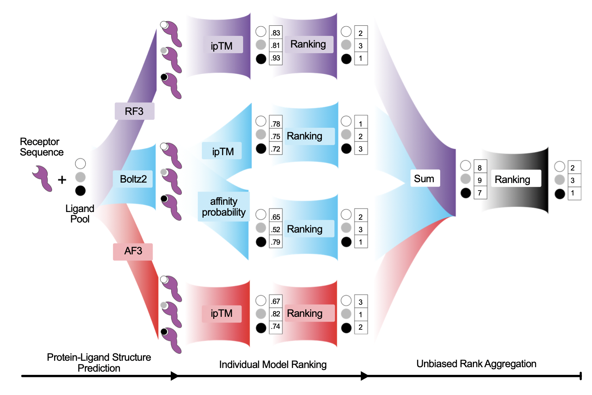

# COPAL

Combining Ordered Predictions of Audited Ligands



**Co-folding ranking of protein–ligand pairs across AlphaFold 3, Boltz2, and RosettaFold3.**

COPAL takes a CSV of protein receptors and a CSV of small-molecule ligands,
runs each receptor × ligand pair through a configurable subset of
{AlphaFold 3, Boltz2, RosettaFold3} on a SLURM cluster, and ranks the
ligands per receptor using an ensemble of confidence-derived scores.

This repository accompanies the paper *“[paper title TBA]”* (Nakajima An et al.).

```
                  receptors.csv         ligands.csv
                       │                     │
                       ▼                     ▼
                       └──────► copal predict ◄──────┐
                                  │                  │
              ┌───────────────────┼───────────────────┐
              ▼                   ▼                   ▼
            AF3 JSON          Boltz2 YAML         RF3 JSON
              │                   │                   │
              └─── SLURM array job (per chunk) ──────┘
                                  │
                                  ▼
                       inputs/, outs/ (predictions)
                                  │
                                  ▼
                          copal organize
                                  │
                       ┌──────────┴──────────┐
                       ▼                     ▼
              copal full-ranking      copal analyze
              (stylized .xlsx;        (benchmark mode:
               label-free, works      top-K, Kendall τ,
               with set=inference)    ablation, etc.)
```

## Quickstart

Install the package with [`uv`](https://docs.astral.sh/uv/):

```bash
uv sync
```

Run the toy example (2 receptors × 3 ligands) end-to-end —
`predict` → `organize` → `full-ranking`:

```bash
cd examples/quickstart
./run.sh                # see examples/quickstart/README.md for prerequisites
```

To predict on **your own** data, just supply two CSVs:

```bash
# Cluster (SLURM) — default
uv run copal predict \
    --receptors my_proteins.csv \
    --ligands   my_ligands.csv \
    --out-dir   ./run \
    --models    af3,boltz2,rf3

# Workstation (no SLURM)
uv run copal predict \
    --receptors my_proteins.csv \
    --ligands   my_ligands.csv \
    --out-dir   ./run \
    --models    af3,boltz2,rf3 \
    --executor  local
```

CSV schemas are documented in [`docs/input_formats.md`](docs/input_formats.md).
The minimum is `receptor_id,seq` and `ligand_id,smiles`.

After the SLURM array completes, organize the raw outputs and rank them.
`copal analyze` is **Hydra-driven** — you pick a benchmark *set* and override
config leaves with `key=value` syntax (no `--flags`):

```bash
# 1. Build the hierarchical predictions store from raw outputs.
uv run copal organize --pred-dir ./run/outs --dst-dir ./run/store

# 2a. Label-free ranking (your own data, no ground truth):
#     emits stylized per-model .xlsx workbooks + full_rankings.csv.
uv run copal full-ranking set=inference

# 2b. Benchmark analysis (curated ground-truth labels): top-K accuracy,
#     Kendall τ, ablation, chemical-similarity, score-vs-rank tables.
uv run copal analyze set=refAHL_all_conf_no_leakage
```

`copal analyze` requires a *set* whose labels CSV carries cognate-AHL ground
truth; for arbitrary data with no labels, use `copal full-ranking set=inference`.
See [`USAGE.md`](USAGE.md) for the full CLI and [`docs/reproduce_paper.md`](docs/reproduce_paper.md)
for the canonical benchmark workflow.

## What you need installed

COPAL itself is pure Python (managed via `uv sync`). The structure
prediction models are external — the repository ships **documentation +
patches**, not the model source:

- **AlphaFold 3** — clone <https://github.com/google-deepmind/alphafold3>,
  apply the optional `third_party/alphafold3-patches/` patch (see
  [`INSTALLATION.md`](INSTALLATION.md)). CC-BY-NC-SA 4.0; non-commercial only.
- **Boltz2** — `pip install boltz` or clone <https://github.com/jwohlwend/boltz>.
  MIT licensed.
- **RosettaFold3 / Foundry** — clone the `production` branch of
  <https://github.com/RosettaCommons/foundry>. BSD-3-Clause.
- **BLAST+** — only required for the RALPH BLAST baseline and the
  `copal seqid-filter` leakage check.

Full setup (containers, weights, env vars) is in
[`INSTALLATION.md`](INSTALLATION.md).

## Reproducing the paper

Two reproduction paths in [`REPRODUCE.md`](REPRODUCE.md):

1. **Analysis-only** (no GPUs needed) — download a ~27 MB pre-collected
   ipTM CSV from a public data archive, run `copal analyze`, generate all
   paper tables.
2. **Full inference** — re-run AF3/Boltz2/RF3 on the benchmark, then
   `copal analyze`.

The exact canonical command sequence (similarity matrix → stylized
workbooks → analysis artifacts) is in
[`docs/reproduce_paper.md`](docs/reproduce_paper.md); per-artifact schemas
are in [`docs/artifacts.md`](docs/artifacts.md).

| Artifact | Hosted |
| -------- | ------ |
| `predictions.csv` | `<DOI_ANALYSIS>` |
| Raw model predictions (CIF + JSON) | `<DOI_PREDICTIONS>` |
| MSAs used at inference | `<DOI_MSAS>` |

Data host and DOIs will be filled in at publication time (TBD).

## Repository layout

```
copal/
├── src/copal/             # importable Python package
│   ├── pipeline.py        # `copal predict`: schedule + emit per-model inputs + SLURM script
│   ├── runner/            # in-tree AF3/Boltz2/RF3 managers + shell templates
│   ├── analysis/          # the analysis pipeline
│   │   ├── pipeline.py    #   `copal analyze` builders (rankings, mpkt, ablation, …)
│   │   ├── run.py         #   Hydra entrypoints for analyze / full-ranking / sim-matrix
│   │   ├── chem_sim.py    #   MCS ligand-similarity methods + pairwise matrix builder
│   │   └── sets.py        #   benchmark-set filtering (split/confidence/leakage/…)
│   ├── config/            # Hydra config tree (set/, analysis/, paths/, sim_matrix/)
│   ├── io/                # receptor & ligand CSV schema + validation
│   ├── prediction_path_managers.py
│   ├── organizer.py
│   └── cli.py             # `copal` entry point (Typer)
├── data/                  # small inputs shipped with the repo
├── examples/              # quickstart + benchmark pointers
├── baselines/ralph_blast/ # BLAST homology baseline
├── third_party/alphafold3-patches/  # 7-decimal AF3 confidence patch (CC-BY-NC-SA 4.0)
├── docs/                  # input formats, pipeline overview, artifacts, reproduction
├── pyproject.toml
└── README.md (this file)
```

The `copal` CLI has six subcommands: `predict` (schedule + run inference),
`organize` (collect raw outputs), `analyze` (benchmark analysis),
`full-ranking` (stylized ranking workbooks), `sim-matrix` (precompute
ligand-similarity matrices), and `seqid-filter` (sequence-identity leakage
filter). Run `copal --help` or see [`USAGE.md`](USAGE.md).

## License

The COPAL source code is licensed under the **MIT License** (see
[`LICENSE`](LICENSE)). The AlphaFold 3 derivative file under
`third_party/alphafold3-patches/confidence_types.py` is **CC-BY-NC-SA 4.0**
(see that directory's `LICENSE` and `NOTICE`). External models invoked at
runtime carry their own licenses — see [`NOTICE`](NOTICE).

## Citation

TBD
```bibtex
```
